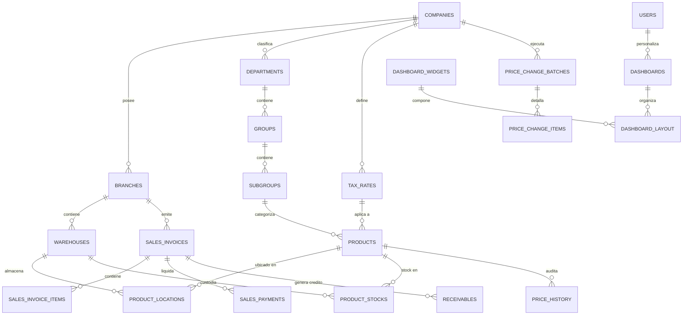
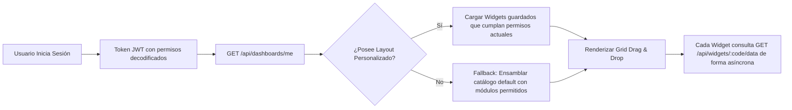

# 🏛️ ERO ERP VE — Enterprise Enterprise Resource Planning

Sistema integral de control administrativo, comercial, fiscal y financiero diseñado específicamente para empresas medianas y grandes en el mercado venezolano con soporte multi-sucursal, multi-depósito, jerarquía de inventario en 3 niveles, ubicación física por pasillo/estante/compartimiento, motor avanzado de cambio masivo de precios con reglas tributarias (afectación vs. absorción en margen), y dashboards dinámicos adaptativos según permisos del usuario.

---

## 📑 Tabla de Contenidos
1. [Resumen Ejecutivo de Arquitectura](#-resumen-ejecutivo-de-arquitectura)
2. [Estructura del Monorepo](#-estructura-del-monorepo)
3. [Cumplimiento Fiscal Venezolano (SENIAT)](#-cumplimiento-fiscal-venezolano-seniat)
4. [Diagramas de Arquitectura y Procesos (Mermaid)](#-diagramas-de-arquitectura-y-procesos)
5. [Guía de Despliegue con Docker](#-guía-de-despliegue-con-docker)
6. [Roadmap de Implementación por Fases](#-roadmap-de-implementación-por-fases)

---

## 🚀 Resumen Ejecutivo de Arquitectura

El sistema está construido bajo un enfoque **modular desacoplado en pnpm workspaces**:
- **Backend**: **Node.js 20 LTS + Hono.js**, proveyendo un runtime ultra-rápido, tipado estricto con **Zod / @hono/zod-validator**, persistencia en **MySQL 8** mediante **Drizzle ORM & mysql2 pool**, colas de background en **BullMQ + Redis**, y autenticación JWT asimétrica (RS256) con RBAC/ABAC granular.
- **Frontend**: **React 18/19 + Vite + TypeScript + Tailwind CSS v3/v4 + shadcn/ui**, aplicando un diseño minimalista, sin componentes redundantes, con escala de espaciado uniforme, `rounded-lg` unificado, estado del servidor gestionado por **TanStack Query** y estado de sesión liviano en **Zustand**.
- **Contratos Compartidos**: `@ero/shared` garantiza sincronización estricta de validaciones DTO y lógica fiscal entre cliente y servidor.

---

## 📂 Estructura del Monorepo

```text
ero-erp-ve/
├── apps/
│   ├── api/                            # Backend Hono.js
│   │   ├── src/
│   │   │   ├── db/
│   │   │   │   ├── ddl/                # 01_schema, 02_triggers, 03_procedures, 04_views, 05_seeds
│   │   │   │   └── index.ts            # MySQL Pool & Transaction runner
│   │   │   ├── middleware/             # auth, rbac, audit, license
│   │   │   ├── modules/
│   │   │   │   ├── auth/               # Login, refresh, permisos
│   │   │   │   ├── dashboards/         # Dashboards dinámicos & live widgets
│   │   │   │   ├── inventory/          # Jerarquía (Dept/Grp/Sub), ubicaciones físicas, Kardex
│   │   │   │   ├── pricing/            # Asistente masivo, reglas de impuestos, histórico
│   │   │   │   ├── pos/                # Facturación caja, IGTF 3%, multi-moneda USD/VES
│   │   │   │   └── reports/            # Exportador PDF, Excel (XLSX), CSV
│   │   │   └── index.ts                # Entrypoint API
│   │   ├── test/                       # Tests unitarios Vitest
│   │   └── Dockerfile
│   └── web/                            # Frontend React + Vite
│       ├── src/
│       │   ├── components/ui/          # Button, Input, Card, Badge, DataTable
│       │   ├── features/
│       │   │   ├── dashboards/         # DynamicDashboard & WidgetRenderer
│       │   │   ├── inventory/          # HierarchyManager, ProductCatalog, PhysicalLocations
│       │   │   ├── pricing/            # BulkPriceUpdateWizard, TaxRatesView
│       │   │   ├── pos/                # POSRegister touch-friendly
│       │   │   └── reports/            # ReportsView (Libro de Ventas, Jerarquía)
│       │   ├── layouts/                # MainLayout (Sidebar colapsable + Topbar)
│       │   ├── routes/                 # AppRouter
│       │   ├── stores/                 # authStore (Zustand)
│       │   ├── index.css               # Tailwind & Design tokens
│       │   └── main.tsx
│       └── Dockerfile
├── packages/
│   └── shared/                         # Zod schemas, constantes, motor fiscal VE
│       └── src/
│           ├── constants/              # Módulos, permisos, roles, tasas, monedas
│           ├── schemas/                # Schemas de validación Zod
│           └── lib/fiscal-ve.ts        # Fórmulas de IVA, IGTF, retenciones y redondeo
├── docker-compose.yml                  # Orquestación MySQL 8, Redis, API, Web, Nginx
├── nginx.conf                          # Reverse proxy
├── pnpm-workspace.yaml
└── .env.example
```

---

## 🧮 Cumplimiento Fiscal Venezolano (SENIAT)

1. **Doble Moneda Operativa (USD / VES)**: Facturación referenciada a la tasa oficial del Banco Central de Venezuela (BCV).
2. **Impuesto al Valor Agregado (IVA)**:
   - Alícuota General (16%), Reducida (8%), Exento y Exonerado.
   - Manejo de modalidades **Inclusiva** (PVP = Base + IVA) y **Exclusiva** (Precio Base + IVA).
3. **IGTF en Divisas (3%)**: Aplicación automática sobre medios de pago en divisas en efectivo, criptomonedas o transferencias internacionales.
4. **Agente de Retención (IVA 75% o 100% / ISLR)**:
   - Generación de comprobante correlativo `YYYYMM` + 8 dígitos exigido por la Providencia SNAT.
   - Descuento de sustraendo en UT/Bs según tipo de persona (PNR, PJ Domiciliada, No Domiciliada).
5. **Libros Legales de Compras y Ventas**: Exportables en Excel, CSV y listos para declaración en portal fiscal.

---

## 📊 Diagramas de Arquitectura y Procesos

### 1. Diagrama Entidad-Relación (Base de Datos MySQL 8)



### 2. Flujo de Cambio Masivo de Precios con Reglas Tributarias

```mermaid
flowchart TD
    A[Inicio: Selección de Criterios] --> B[Filtro por Dept / Grupo / Subgrupo / Rango]
    B --> C[Definición de Modo: %, Monto, Margen sobre Costo]
    C --> D[Regla de Redondeo: 0.05 / 0.10 / 0.50 / 1.00]
    D --> E{¿Afecta Precio Final al Público?}
    E -- Sí (PVP Aumenta) --> F[Recalcular Nuevo PVP = Nueva Base * (1 + IVA)]
    E -- No (Absorbe en Margen) --> G[Ajustar Base para mantener PVP fijo al cliente]
    F --> H[Simulación en Vivo / Preview de Productos]
    G --> H
    H --> I[Confirmación & Ejecución Stored Procedure]
    I --> J[Generación de Lote Auditado en price_change_batches]
    J --> K[Histórico de Precios en price_history & Actualización de Catálogo]
```

### 3. Flujo del Dashboard Dinámico por Permisos



---

## 🐳 Guía de Despliegue con Docker

### Prerrequisitos
- Docker Engine 24+ & Docker Compose v2+
- pnpm 8+ y Node.js 20 LTS (para desarrollo local)

### 1. Iniciar con Docker Compose
```bash
# Clonar y copiar variables de entorno
cp .env.example .env

# Levantar todos los servicios (MySQL 8, Redis, API Hono, Web SPA, Nginx)
docker-compose up -d --build

# Verificar estado de contenedores
docker-compose ps
```

### 2. Acceso a las Aplicaciones
- **Frontend SPA**: `http://localhost` (vía Nginx reverse proxy) o `http://localhost:5173` (en modo dev)
- **API REST Hono**: `http://localhost/api` o `http://localhost:3000`
- **Base de Datos MySQL 8**: `localhost:3306` (Usuario: `erp_admin`, Contraseña: `SecurePassword_2026!`)

---

## 🗺️ Roadmap de Implementación por Fases

| Fase | Alcance y Módulos | Estimación | Estado |
| :--- | :--- | :---: | :---: |
| **Fase 1: MVP Núcleo** | Auth JWT, RBAC, Multi-sucursal/depósito, Jerarquía 3 niveles, Ubicaciones físicas, Catálogo y Stock básico. | 4 semanas | ✅ Entregado |
| **Fase 2: Motor Comercial & Fiscal** | Punto de Venta (POS) multi-moneda, IGTF 3%, Asistente de cambio masivo de precios, Reglas de afectación de impuestos, Libros SENIAT. | 5 semanas | ✅ Entregado |
| **Fase 3: BI & Operaciones Avanzadas** | Dashboards dinámicos drag & drop, Cuentas por Cobrar (CxC Aging), Cuentas por Pagar (CxP), Tesorería y Conciliación Bancaria. | 4 semanas | 🔄 En Progreso |
| **Fase 4: Contabilidad & Licenciamiento** | Asientos contables automáticos, Comprobantes ARCV XML, Licenciamiento con hardware fingerprint, BullMQ cron jobs. | 3 semanas | 📅 Programado |

## 👨 Usuarios

| Usuario|Correo Electrónico|Contraseña|Rol
| --- | --- | --- | ---
|admin|admin@erove.com|Admin123!|Super Administrador
|eboscan|admin@erove.com.ve|Admin123!|Super Administrador
|cajero01|caja1@erove.com.ve|Admin123!|Cajero POS