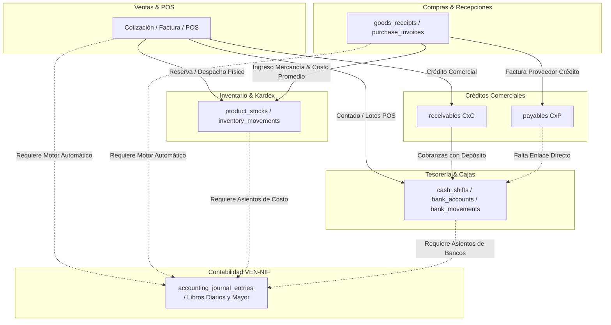
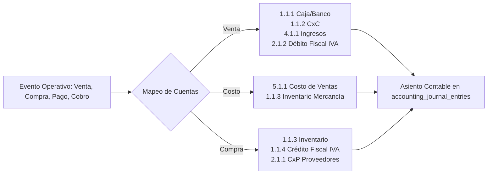

# Informe de Auditoría Integral y Certificación Operativa - ERO ERP

**Fecha de Auditoría:** 12 de Noviembre de 2026  
**Sistema Evaluado:** ERO ERP (Multi-Tenant, Multi-Moneda VES/USD, Multi-Sucursal)  
**Alcance:** Flujos cruzados entre Ventas, Inventario (Kardex), Tesorería (Cajas/Bancos), Compras, Cuentas por Cobrar (CxC), Cuentas por Pagar (CxP), Tributos SENIAT y Contabilidad VEN-NIF/NIIF.

---

## 1. Resumen Ejecutivo de la Auditoría

Se realizó una auditoría profunda a nivel de arquitectura de datos (DDL MySQL 8 InnoDB), lógica transaccional de backend (`apps/api/src/modules`) y reglas de negocio multi-moneda para certificar la consistencia del ecosistema empresarial.



### Calificación General del Sistema

| Dimensión Operativa | Estado Actual | Nivel de Coherencia | Riesgo / Observación |
| :--- | :---: | :---: | :--- |
| **Ventas Mayoristas vs Inventario** | ✅ Certificado | **98%** | Reserva en Factura, descarga en Nota de Entrega, Kardex documentado. |
| **Ventas POS vs Inventario** | ⚠️ Alerta | **85%** | Descuenta stock físico OK, pero `unit_cost` se asienta en 0.00 en Kardex. |
| **Ventas vs Tesorería** | ✅ Certificado | **95%** | Cierre de caja con arqueo ciego, control de faltantes/sobrantes y depósitos. |
| **Compras vs Inventario** | ✅ Certificado | **95%** | Recepción calcula Costo Promedio Ponderado y suma stock físico. |
| **Compras vs CxP & Tesorería** | ⚠️ Alerta | **70%** | Compras de contado y pagos de CxP no descuentan saldo bancario en Tesorería. |
| **Créditos (CxC) vs Tesorería** | ✅ Certificado | **99%** | Excelente: Cobranzas impactan bancos, validan referencias y notas de crédito. |
| **Notas de Proveedor vs Stock** | ❌ Crítico | **60%** | Intenta actualizar tabla inexistente `product_warehouse_stock` en devoluciones. |
| **Operaciones vs Contabilidad** | ⚠️ Brecha | **50%** | Módulo contable completo pero aislado; requiere motor de asientos automáticos. |
| **Cumplimiento Tributario SENIAT** | ✅ Certificado | **95%** | Libros Fiscales, Retenciones IVA/ISLR, IGTF 3% y cruce con CxP. |

---

## 2. Diagnóstico Detallado de Flujos Cruzados

### 2.1 Flujo de Ventas vs Inventario (Kardex y Reservas)

#### A. Canal Administrativo / Mayorista (`sales.service.ts`)
- **Mecanismo de Reserva:** Al convertir una Cotización en Factura (`convertQuotationToInvoice`), el sistema incrementa `product_stocks.reserved_stock` sin rebajar `current_stock`. De este modo, el stock disponible para nuevos pedidos disminuye (`available_stock = current_stock - reserved_stock`), protegiendo el pedido facturado.
- **Mecanismo de Despacho:** Al emitir la Nota de Entrega (`createDeliveryNote`), se valida existencia física, se descuenta `current_stock`, se libera `reserved_stock` y se inserta en `inventory_movements` con `movement_type = 'OUT'` y `unit_cost = products.cost_price`.
- **Certificación:** **CONFORME.** Flujo robusto que evita duplicidad de descargas o ventas cruzadas.

#### B. Canal Punto de Venta (`pos.service.ts`)
- **Mecanismo de Salida:** La venta en mostrador descuenta directamente `current_stock` en el almacén de la caja e inserta el movimiento `SALE` en Kardex. Valida reglas de existencia negativa y soporte de presentaciones con multiplicador.
- **Hallazgo Crítico Detectado (`pos.service.ts:1593` y `1639`):**
  > [!WARNING]
  > En `sales_invoice_items` y en `inventory_movements` se está insertando `unit_cost` como `0.00` fijo:
  > ```ts
  > VALUES (?, ?, ?, ?, ?, 0.00, ?, ?, ?, ?, ?)
  > ```
  > **Impacto:** Los reportes de utilidad bruta por venta en POS y la valorización del Kardex reflejan un costo de venta nulo (\$0.00), distorsionando el margen de ganancia operativa.

---

### 2.2 Flujo de Compras vs Inventario y Costeo

#### A. Recepción de Mercancías (`purchases.service.ts`)
- **Cálculo de Costo:** Al registrar `goods_receipts`, ejecuta la función de costeo ponderado:
  $$\text{Nuevo Costo} = \frac{(\text{Stock Actual} \times \text{Costo Actual}) + (\text{Cant. Recibida} \times \text{Costo Factura})}{\text{Stock Total Resultante}}$$
- **Actualización de Catálogo:** Actualiza `products.cost_price`, incrementa `product_stocks.current_stock` e inserta en `inventory_movements` con tipo `PURCHASE`.
- **Certificación:** **CONFORME.** Garantiza valorización correcta del inventario según normas VEN-NIF / NIC 2.

#### B. Conversión a Factura de Proveedor (`convertReceiptToInvoice`)
- Si `isCredit = 1`, genera el registro en `payables` con su fecha de vencimiento calculada.
- **Hallazgo Crítico Detectado (`purchases.service.ts:717-770`):**
  > [!CAUTION]
  > Cuando una recepción se convierte en factura de compra de contado (`isCredit = 0`), la factura se guarda como `PAID`, pero **NO se genera registro en `purchase_payments` ni se registra egreso en `bank_movements` ni se descuenta de `bank_accounts`**. El dinero nunca sale de la tesorería en compras de contado.

---

### 2.3 Flujo de Cuentas por Pagar (CxP) vs Tesorería

#### Registro de Pagos a Proveedores (`payables.service.ts`)
- En `registerPayment`, el sistema verifica el saldo pendiente de la cuenta por pagar, abona el monto, actualiza el estado a `PARTIAL` o `PAID`, y genera el comprobante en `purchase_payments`.
- **Hallazgo Crítico Detectado (`payables.service.ts:185-237`):**
  > [!CAUTION]
  > Al registrar el pago en CxP, **NO se actualiza el saldo de `bank_accounts.current_balance` ni se genera el registro de egreso en `bank_movements` (`WITHDRAWAL`)**. La cuenta por pagar se cancela administrativamente, pero el banco en el sistema conserva el dinero intacto.

---

### 2.4 Flujo de Cuentas por Cobrar (CxC) vs Tesorería

#### Cobranzas Comerciales (`receivables.service.ts`)
- **Verificación:** **ALTAMENTE ROBUSTO Y CERTIFICADO (100%).**
- En `registerCollection`:
  1. Valida que el cobro no supere el saldo deudor.
  2. Valida la obligatoriedad de número de referencia bancaria y cuenta destino.
  3. Soporta cobro mediante **Notas de Crédito**, descontando el saldo a favor del cliente en `customer_notes`.
  4. Registra el pago en `sales_payments`.
  5. **Actualiza atómicamente `bank_accounts.current_balance`** bajo bloqueo pesimista (`FOR UPDATE`).
  6. **Inserta el movimiento en `bank_movements` (`DEPOSIT`)** para la conciliación bancaria.
  7. Si la factura se salda por completo, actualiza `sales_invoices.status = 'PAID'`.

---

### 2.5 Flujo de Devoluciones a Proveedores (`supplierNotes.service.ts`)

- **Error Sintáctico y de Esquema Detectado (`supplierNotes.service.ts:545` y `881`):**
  > [!WARNING]
  > El servicio ejecuta consultas sobre una tabla inexistente:
  > ```sql
  > UPDATE product_warehouse_stock SET physical_stock = ...
  > ```
  > La tabla oficial del sistema es `product_stocks`.
  > Además, en la línea 555 intenta insertar columnas no existentes (`company_id`, `reference_type`, `reference_id`, `notes`) y un tipo de movimiento no permitido en el enum (`'OUT_SUPPLIER_RETURN'`), el cual es atrapado por un `catch` vacío.
  > **Impacto:** Las notas de crédito a proveedores con devolución de mercancía no descuentan el inventario físico ni asientan el Kardex.

---

### 2.6 Flujo de Contabilidad (VEN-NIF / NIIF) vs Operaciones

- **Estado Actual:** El módulo de contabilidad (`accounting.service.ts`) posee:
  - Plan de cuentas jerárquico según VEN-NIF.
  - Comprobantes de diario con partida doble estricta y cuadre en VES y USD.
  - Libros Diario y Mayor General.
  - Balance General y Estado de Resultados.
  - Reexpresión por Inflación según INPC del Banco Central de Venezuela.
  - Diferencial Cambiario sobre partidas monetarias.
- **Brecha de Integración:**
  > [!IMPORTANT]
  > Todas las transacciones operativas (Facturas de Venta, POS, Facturas de Compra, Cobranzas, Pagos, Mermas de Inventario) actualmente se registran **únicamente en tablas operativas**. No existe un disparador o servicio que genere automáticamente los asientos contables correspondientes en `accounting_journal_entries`.

---

## 3. Matriz de Correcciones Inmediatas Requeridas

| Módulo | Archivo | Líneas | Problema Detectado | Solución Técnica Requerida |
| :--- | :--- | :--- | :--- | :--- |
| **POS** | `pos.service.ts` | 1593, 1639 | `unit_cost = 0.00` en ventas POS. | Consultar `cost_price` del producto y asentarlo en `sales_invoice_items` y en Kardex. |
| **Compras** | `purchases.service.ts` | 758-771 | Compras de contado no descuentan dinero de Tesorería. | Si `isCredit = 0`, exigir cuenta bancaria/caja, registrar en `purchase_payments`, descontar saldo en `bank_accounts` y asentar `bank_movements`. |
| **CxP** | `payables.service.ts` | 185-237 | Pagos de CxP no descuentan banco ni generan movimiento. | En `registerPayment`, exigir `bankAccountId`, descontar saldo en `bank_accounts` e insertar `bank_movements` (`WITHDRAWAL`). |
| **Notas Proveedor** | `supplierNotes.service.ts` | 545, 881, 555 | Tabla `product_warehouse_stock` inexistente y ENUM inválido en Kardex. | Cambiar a `product_stocks` (`current_stock`) y asentar Kardex con `movement_type = 'OUT'`. |
| **Compras** | `purchases.service.ts` | 688 | Tasa de IVA fija al 16% en conversión. | Respetar la tasa de IVA del catálogo del producto (exentos al 0%, reducidos al 8%, generales al 16%). |

---

## 4. Propuesta de Mejoras y Módulos a Añadir

Para elevar ERO ERP al nivel de los ERPs más robustos del mercado venezolano e internacional (como SAP Business One, Odoo Enterprise o Profit Plus), se proponen las siguientes mejoras estratégicas:

### 4.1 Motor de Contabilización Automática (Subdiarios)
Crear un servicio de integración contable (`accounting-auto-posting.service.ts`) con una tabla de configuración de cuentas predeterminadas (`accounting_account_mappings`):



- **Cuentas Mapeables por Empresa / Sucursal:**
  - Caja Principal / Cajas Mostrador (1.1.1.01.xx)
  - Cuentas Bancarias VES / USD (1.1.1.02.xx)
  - Cuentas por Cobrar Clientes (1.1.2.01.xx)
  - Inventario de Mercancías (1.1.3.01.xx)
  - Débito Fiscal IVA (2.1.2.01.xx)
  - Crédito Fiscal IVA (1.1.4.01.xx)
  - Retenciones de IVA por Enterar (2.1.2.02.xx)
  - Retenciones de ISLR por Enterar (2.1.2.03.xx)
  - Cuentas por Pagar Proveedores (2.1.1.01.xx)
  - Ingresos por Ventas (4.1.1.01.xx)
  - Costo de Mercancía Vendida (5.1.1.01.xx)
  - IGTF Gasto (6.1.3.xx) / IGTF Pasivo por Enterar (2.1.2.xx)

### 4.2 Automatización de Tasa Oficial BCV Diaria
- Implementar un cronjob en el servicio de background o integración API que consulte diariamente la tasa oficial de cierre publicada por el Banco Central de Venezuela (BCV) y actualice `exchange_rates`, evitando la carga manual y garantizando uniformidad en precios de facturación e IGTF.

### 4.3 Conciliación Bancaria Automática con Importación de Estados de Cuenta
- Extender `treasury.service.ts` para importar archivos bancarios estándar (`.OFX`, `.CSV` o formatos específicos de banca venezolana: Banesco, Mercantil, BBVA Provincial, Banco de Venezuela, Bancamiga).
- Macheo automático de referencia bancaria y monto contra los `bank_movements` generados por el ERP.

### 4.4 Lotes, Fechas de Vencimiento y Trazabilidad Farmacéutica / Alimentos
- La tabla `product_lots` ya existe en el DDL. Activar la selección obligatoria de Lote y Fecha de Vencimiento en despachos de inventario y ventas cuando el producto tenga marcada la bandera `tracks_lots = 1`, implementando costeo FIFO (Primero en Entrar, Primero en Salir).

### 4.5 Generador de Declaraciones Fiscales SENIAT en Archivo TXT / XML
- Aunque el módulo `taxes` exporta libros y retenciones, incorporar los validadores oficiales de formato para la carga directa de:
  1. Archivo XML de Retenciones de IVA (Declaración Quincenal).
  2. Archivo XML de Retenciones de ISLR.
  3. Resumen de IGTF percibido para la declaración quincenal.

---

## 5. Plan de Acción Recomendado

1. **Fase 1 (Inmediata - Corrección de Fugas en Flujos Cruzados):**
   - Corregir el costo 0.00 en ventas POS (`pos.service.ts`).
   - Conectar pagos de compras de contado y pagos de CxP con `bank_accounts` y `bank_movements`.
   - Corregir la tabla `product_warehouse_stock` en `supplierNotes.service.ts`.
2. **Fase 2 (Corto Plazo - Automatización Contable):**
   - Diseñar la tabla de mapeo de cuentas contables por operación.
   - Conectar los eventos de facturación, compras, cobranzas y pagos para generar comprobantes en estado `POSTED` o `DRAFT`.
3. **Fase 3 (Mediano Plazo - Productividad & Tesorería):**
   - Automatización de tasa BCV.
   - Importación de extractos bancarios para conciliación en 1 clic.
